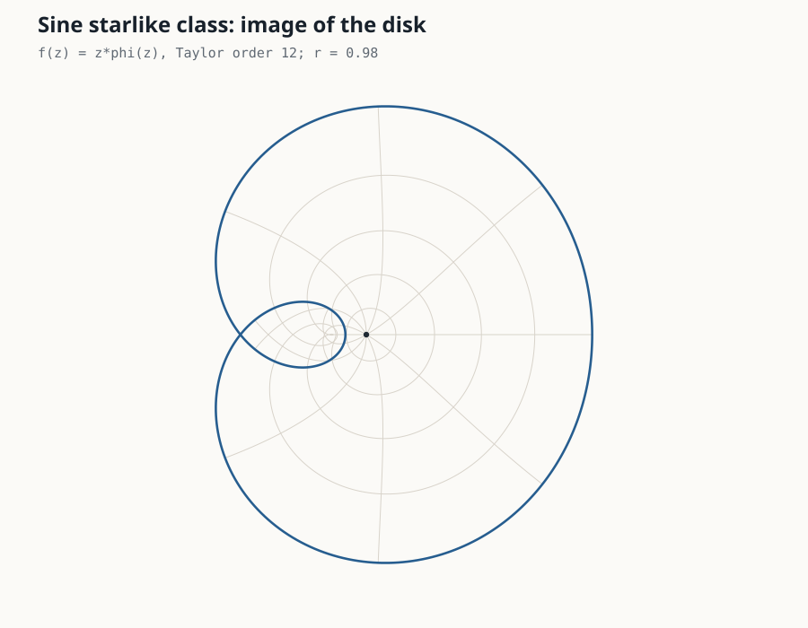
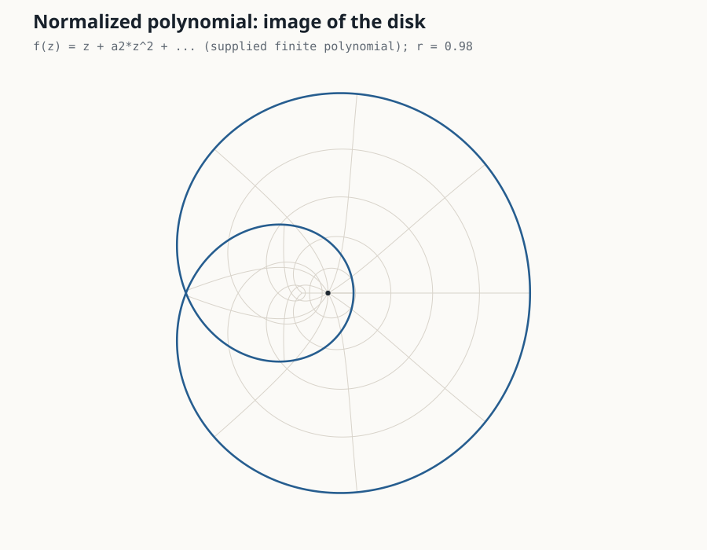

# geometric-function-atlas

`geometric-function-atlas` is a standalone Python package for independently reproducing and reviewing computations published by the [Geometric Function Atlas](https://gft-registry.fly.dev).

Source repository: <https://github.com/Prasanna28Devadiga/geometric-function-atlas>

This repository is intentionally separate from the registry website and its research workspace. It provides local commands and Python functions for reproducing the website's mathematical computations. It does not contain the Flask application, deployment configuration, private review state, or mutable registry database.

## Install

**No Python required.** On macOS or Linux, run:

```bash
curl --proto '=https' --tlsv1.2 -LsSf https://raw.githubusercontent.com/Prasanna28Devadiga/geometric-function-atlas/main/scripts/install.sh | sh
```

On Windows, open PowerShell and run:

```powershell
irm https://raw.githubusercontent.com/Prasanna28Devadiga/geometric-function-atlas/main/scripts/install.ps1 | iex
```

Then take the guided tour:

```text
gfa walkthrough
```

These commands use the package repository's installers (the website-hosted
installer endpoints are maintained separately). Both scripts install the immutable
published v0.6.0 wheel and create the `gfa` command with a uv-managed Python;
they do not require a preinstalled Python. The
[getting-started guide](https://prasanna28devadiga.github.io/geometric-function-atlas/getting-started/)
walks through the first calculations.

## What you can do

Every operation represented in the package's parity table has a local command
and a Python function. The table below is the complete shipped surface; browser-
only panels and private research-workspace operations are explicit non-goals.

| Website capability | CLI | Python function |
|---|---|---|
| Run a concise first-use tour | `gfa walkthrough` | — |
| Browse the generator catalog (39 keys; 38 distinct formulas) | `gfa generators` | `list_generators()` |
| Exact Taylor coefficients of a generator | `gfa coefficients <gen> --order N` | `generator_series()` |
| Exact Ma–Minda Fekete–Szegő constants | `gfa fekete-szego <gen> --mu M` | `fekete_szego()` |
| Versioned coefficient tables (H₃ lower witnesses; sharp a₃ and a₂a₃) | `gfa coefficient-table hankel3_1|a3|a2a3 --json` | `coefficient_table()` |
| Re-check a supplied counterexample witness | `gfa verify-counterexample` | `verify_counterexample()` |
| Search for and certify a violation point | `gfa find-counterexample` | `find_counterexample()` |
| Verify a function at a cost tier | `gfa verify --max-cost <tier>` | `verify_function()` |
| List Ma–Minda classes | `gfa classes` | `list_classes()` |
| Check Ma–Minda admissibility of a class | `gfa class-check <key>` | `class_admissibility()` |
| Screen membership of f in a class | `gfa class-member <key> --coefficients ...` | `class_member_screen()` |
| Screen class containment | `gfa compare <inner> <outer>` | `class_containment_screen()` |
| Exact extremal coefficients of a class | `gfa extremal-coefficients <key>` | `class_extremal_coefficients()` |
| Export citations | `gfa citation ...` | `citation_export()` |
| Reproduce website plots | `gfa plot <kind> <gen> [--object phi\|z*phi\|f_phi] --output out.svg` (domain also supports PNG/TikZ) | `write_plot()` and friends |
| Inspect/verify baked scientific artifacts | `gfa artifact-snapshot`, `gfa proofs`, `gfa expansion`, `gfa coefficient-bound`, `gfa reconciliation` | `snapshot_info()`, `list_proofs()`, `expansion()`, `coefficient_bound()`, `reconciliation()` |
| Replay a baked exact certificate | `gfa verify-certificate <name>` | `verify_certificate()` |
| Browse/replay directed inclusion radii | `gfa radii`, `gfa radius`, `gfa radius-recompute`, `gfa radius-identify`, `gfa radius-audit`, `gfa radius-attainment`, `gfa verify-radius-certificate` | `list_radii()`, `radius()`, `recompute_radius()`, `identify_radius()`, `audit_radius()`, `verify_radius_attainment()`, `verify_radius_certificate()` |
| Verify/install an immutable registry snapshot | `gfa snapshot info|verify|install` | `verify_snapshot()`, `install_snapshot()`, `RegistrySnapshot.open()` |
| Query snapshot statistics, families, papers, evidence, applications, legacy functions, facets, and tags | `gfa stats|search|families|family|facts|evidence|runs|papers|paper|applications|function|functions|paper-facets|tags` | `RegistrySnapshot.stats()`, `.search()`, `.families()`, `.family()`, `.facts()`, `.evidence()`, `.runs()`, `.papers()`, `.paper()`, `.applications()`, `.function()`, `.legacy_functions()`, `.paper_facets()`, `.tags()` |
| Query aliases, hierarchy, and stored witnesses | `gfa aliases|normalize-class|hierarchy|counterexamples` | `RegistrySnapshot.aliases()`, `.normalize_class()`, `.hierarchy()`, `.counterexamples()` |
| Cryptography Lab S-box metrics (optional) | `gfa crypto-lab ...` | `geometric_function_atlas.lab.*` |
| Image Lab finite coefficient-derived filters, metrics, and transforms (optional) | `gfa image-lab ...` | `geometric_function_atlas.lab.*` |

The built-in catalog has **39 catalog keys, 38 distinct generator formulas**:
`janowski_A0_B-1` and `order_0.5` both equal `1/(1-z)` exactly. Both keys
remain supported for historical radius records and source locators; they are
not independent mathematical generators. The directed-radius snapshot is
alias-inclusive; see [the count reconciliation](docs/RADIUS_COUNT_RECONCILIATION.md).

Result-printing commands accept `--json` for machine-readable output;
file-writing commands (`plot`, `image-lab transform`, `image-lab sample`)
write their artifact instead. Without `--json`, result commands print a short
human summary (the value plus its evidence label) and point to `--json` for
the complete versioned record.

Short aliases save typing: `gfa coeffs`, `gfa fs`, `gfa disprove`, and
`gfa certify` stand for `coefficients`, `fekete-szego`,
`verify-counterexample`, and `verify-radius-certificate`. A misspelled
generator key earns a `did you mean ...?` suggestion, and witness points may
use fraction syntax with `--at` (`gfa disprove --coefficients 1 --at=-3/4`).

Low-level exact research helpers also include `inverse_coefficients([a2,...,a5])`
for formal inverse jets and `schippers_origin([a2,a3,a4])` for the classical
Schwarzian and next Schippers invariant **at the origin**. They return exact
SymPy tuples, not global bounds, inverse-domain certificates or disk norms.
For example, the Koebe jet `[2,3,4,5]` gives inverse `(-2,5,-14,42)`;
its initial Schippers invariants are `(-6,48)`.
`schwarzian_derivative_origin([a2,a3,a4])` instead returns the **ordinary**
derivative `S_f'(0)=24*(a4-2*a2*a3+a2**3)`. For Koebe it is zero, not sigma4=48.
Exactly three exact coefficients are required. This scalar low-level API proves
no disk norm, global univalence, sharp bound, or whole-paper result.

`hadamard_coefficients(left, right)` computes exact coefficientwise products of
normalized jets a2..a9 (equal nonempty lengths, at most eight terms). Unknown
tails are never zero-padded. This API is not ordinary multiplication and proves
no global convolution theorem or class membership; see
[bounded Hadamard jets](docs/workflows/hadamard-jets.md).

## Registry snapshot boundary

The package does not bundle the mutable registry database, and no canonical snapshot URL is bundled.
Snapshot users provide a user-supplied HTTPS database and matching manifest
(the manifest can preserve its `source_url`), then verify
and install it locally:

```bash
gfa snapshot install https://example.org/registry.sqlite \
  ~/.cache/gft-registry/registry.sqlite --manifest registry.manifest.json
gfa papers --citation 10.example/record \
  --snapshot ~/.cache/gft-registry/registry.sqlite --manifest registry.manifest.json
```

The URL above is an illustrative caller input, not a package-hosted release
asset. Snapshot hashes, required tables, populations, and SQLite integrity
checks are authoritative; a snapshot does not certify the underlying claims.

The optional crypto lab covers five named registry functions and two
deterministic S-box constructions. Its outputs are benchmark metrics, never
security claims; invertibility and empirical comparisons do not amount to
provable cryptographic security. `leaderboard(scope="website")` and
`gfa crypto-lab leaderboard --scope website` replay the immutable 435-row
website metric snapshot; those rows contain reported metrics, not S-box values,
and are not a new security ranking. The image lab is likewise an empirical
transform/metric sandbox. It accepts finite, non-empty 2D (`H×W`) or RGB
(`H×W×3`) arrays and exposes the finite coefficient-derived filter subset used
by the website's named functions. GMSD mirrors the website's 2×2 prefilter,
including its treatment of odd-sized inputs; the package does not claim analytic
special-function or conformal-warp parity.

## Python API

For problem-led examples rather than an API tour, choose one of five
[research workflows](docs/workflows/README.md): understand a Ma–Minda class,
investigate a coefficient problem, prove an inclusion radius, test a conjecture,
or reproduce and adapt a published result.

### Exact generator series

```python
from geometric_function_atlas import Generator, generator_series, z

# phi(z) = 1 + sin(z) = 1 + z - z^3/6 + ...
series = generator_series("sine", order=4)
assert tuple(map(str, series.coefficients)) == (
    "1", "0", "-1/6", "0"
)
print(series.to_dict())
```

Custom normalized generators use preconstructed SymPy expressions; formula
strings are deliberately rejected rather than passed to an eval-based parser:

```python
custom = Generator(
    key="custom",
    name="Example",
    expression=1 + 2*z + 3*z**2,
    citation="User supplied",
)
```

Computations are not restricted to the built-in catalog. Analytic admissibility
of custom input remains an explicit caller assumption, and undeclared free
symbols are rejected. Caller definitions receive a collision-safe canonical
identity of the form `user:<key>:<SHA-256 of exact formula>` in exported
records; reusing a catalog key cannot impersonate the built-in object.

### Bernardi and integer-parameter q-Al-Oboudi multipliers (low-level API)

`bernardi_coefficients(jet, gamma=g, inverse=False)` applies
`a_n -> (g+1)*a_n/(g+n)` for exact rational `g>=0`, on one to eight exact
coefficients `a2..a9`. This is the normalized Bernardi integral
`I_g f=(g+1)*z**(-g)*integral_0^z t**(g-1)*f(t) dt`, equivalently defined
by its series. The identity `z*F'+g*F=(g+1)*f` anchors the convention;
`g=0` gives `integral_0^z f(t)/t dt`, not `f`.

`euler_differential_coefficients(jet, second=a, first=b, inverse=False)`
applies the normalized Euler differential expression `a*z**2*f''+b*z*f'+(1-b)*f`
with exact rational a,b to a2..a9 (length1..8). Inverse mode divides the
multipliers `1+b*(n-1)+a*n*(n-1)` and rejects a zero multiplier, even for a zero
input coefficient. This is coefficientwise inversion, not functional inversion,
analytic continuation, univalence, preservation or a global bound. Generic
polynomial differentiation independently anchors the convention; a literature
application is DOI10.47772/IJRISS.2026.100300432 Eq8/10 at m0.

`q_al_oboudi_coefficients(jet, q=q, lam=L, degree=m, inverse=False)`
applies `[1+(n-1)*L]_q**m`, **not** `[n*L]_q**m` or
`(1+L*([n]_q-1))**m`. Parameters are exact rational `0<q<=1`, integer
`L=1..64`, integer `m=0..64`, and one to eight exact coefficients. At `L=1`
this is the iterated Jackson Euler operator; `q=1` is the classical limit.
Noninteger lambda is deliberately unsupported. Both inverses divide the
multipliers; neither means functional inversion. Both return bare exact tuples,
not global membership, preservation, univalence, tail or bound certificates.
Source applications: DOI10.36948/ijfmr.2026.v08i05.89311, Definition2.3 Eq(2)-(3),
and DOI10.5269/bspm.79733
Eq(1.3)-(1.5). Formula discrepancies in either paper are not endorsed.

### Normalized Owa fractional multipliers (low-level API)

`owa_fractional_coefficients(jet, rho=rho, inverse=False)` applies
`Gamma(n+1)*Gamma(2-rho)/Gamma(n+1-rho)` to initial a2..a9, length1..8,
for an exact rational `0<=rho<=1`. It is the normalized operator
`Omega^rho f=Gamma(2-rho)*z^rho*D^rho f`; rho0 is identity and rho1 is the
endpoint `z*f'`, not an iterated fractional derivative. A finite rational product
avoids numerical gamma evaluation. `inverse=True` divides these multipliers,
not functional reversion. The bare exact tuple certifies no global analyticity,
univalence, preservation, omitted tail or source theorem. Source applications:
DOI10.5269/bspm.79103 Eq1.7 and DOI10.5269/bspm.79357 Definition1.2.

### Linear subordinations and ordinary logarithms (low-level API)

`linear_subordination_coefficients(B, gammas, alpha=alpha, order=N)` returns
`a2..a_(N+1)` for `(1-alpha)f/z + alpha*f' = phi(omega)` with exact rational
`0 <= alpha <= 1`. At alpha=1 this is bounded turning, **not** convexity;
at alpha=0 it is `f/z` subordination. It recovers the composed generator via
the existing starlike recurrence rather than maintaining another Schur engine.
Real rational Schur parameters, depth five, order eight, polynomial treatment
of omitted B entries, and caller-owned analytic hypotheses are unchanged.

`logarithmic_coefficients([a2,...,a5])` accepts one to four exact coefficients
and returns the corresponding signed gamma1..gamma4 with
`log(f(z)/z)=2 sum gamma_n*z^n`. For example:

```python
import sympy as sp
from geometric_function_atlas import linear_subordination_coefficients, logarithmic_coefficients
jet = linear_subordination_coefficients([1,0,-sp.Rational(1,3)], [1], alpha=1, order=3)
assert jet == (sp.Rational(1,2), 0, -sp.Rational(1,12))  # f'=1+tanh(z)
assert logarithmic_coefficients([2,3,4]) == (1,sp.Rational(1,2),sp.Rational(1,3))
```

Both return exact tuples only, not theorem certification, global extremization,
whole-function tail declarations, or newly released CLI commands.

### Mixed derivative and product subordinations (low-level API)

`mixed_derivative_coefficients(B, gammas, alpha=alpha, order=N)` solves the
**different, nonlinear** equation `(1-alpha)f' + alpha*(1+zf''/f')=phi(omega)`.
Alpha is an exact rational in [0,1]; endpoints are bounded turning and convexity.
The triangular formal solution at interior alpha does not certify analytic
continuation or nonvanishing of f' on the whole disk.

`product_subordination_coefficients(base, B, gammas, order=N)` returns the jet of
`f=g*phi(omega)`, with exactly N exact base coefficients `[b2,...,b_(N+1)]`.
For example, a Koebe base `[2,3,4]`, sine B=`[1,0,-Rational(1,6)]` and `[1]`
(omega=z) returns `(3,5,Rational(41,6))`; this is **not** sine starlikeness.
Both reuse real Schur composition, with depth five/order eight, return exact
bare tuples and certify no global bound, univalence, unknown tail or theorem.

### Ruscheweyh coefficient multipliers (low-level API)

`ruscheweyh_coefficients([a2,...,a9], degree=m, inverse=False)` applies
`D^m f = z + sum binomial(m+n-1,n-1)*a_n*z^n` to a nonempty exact jet
of length at most eight, for integer `0 <= m <= 64`. `inverse=True` divides
by those multipliers; it is **not functional inversion**. For example,
`ruscheweyh_coefficients([1,1,1], degree=2)` returns `(3,6,10)`.
Independent differentiation of `z/m! * (z^(m-1)*f)^(m)` anchors the convention.
This API returns exact tuples only, not global membership, univalence, unknown
tail, or theorem certification. Source application: DOI10.5269/bspm.83160 (1.4).

### Jackson q-difference jets (low-level API)

`q_starlike_member_coefficients(B, gammas, q=q, order=N)` solves the formal
coefficient equation `z*D_q f/f=phi(omega)`, where
`D_q f=(f(z)-f(q*z))/((1-q)*z)`. Exact rational `0<q<=1` is required;
`q=1` is the ordinary derivative limit. It reuses real Schur composition
(depth five, order eight, omitted B entries mean a polynomial generator).
The coefficient divisor is `[n+1]_q-1`, not `n` or `[n]_q`.

`q_ruscheweyh_coefficients(jet, q=q, degree=m, inverse=False)` applies
`[m+n-1]_q!/([m]_q!*[n-1]_q!)` to a2..a9. Integer degree0..64 only;
noninteger q-gamma conventions are not implemented. `inverse=True` divides
multipliers, not functional inversion. At q=1 this equals the ordinary API.
For example, q=1/2, degree1 maps `[1,1,1]` to `(3/2,7/4,15/8)`.
Existing exact-expression resource bounds still apply to input jets.

These return bare exact tuples, not global q-starlikeness, analyticity,
nonvanishing, univalence, bounds, or unknown-tail certificates. In particular,
the triangular q-difference solution can have poles in the disk; a finite jet
alone does not establish class membership. Source application:
DOI10.5269/bspm.81781 Definition1.1/1.2; this does not endorse its formulas.

### Exact convex jets and inverse logarithms (low-level API)

```python
import sympy as sp
from geometric_function_atlas import (
    Generator, convex_member_coefficients, generator_series,
    inverse_logarithmic_coefficients, z,
)

apple = Generator(key="apple", name="Apple-like", expression=sp.exp(z)*sp.sqrt(1+z),
                  citation="arXiv:2606.15780v1, Theorem 3.1, equations (3.1)-(3.3)")
B = generator_series(apple, order=3).coefficients
jet = convex_member_coefficients(B, [1], order=3)  # omega(z)=z
assert jet == (sp.Rational(3,4), sp.Rational(25,48), sp.Rational(385,1152))
assert inverse_logarithmic_coefficients(jet) == (
    -sp.Rational(3,8), sp.Rational(31,192), -sp.Rational(205,2304),
)
```

`convex_member_coefficients` reuses the bounded Schur recurrence and Alexander's
identity, returning `[a2,...,a_(order+1)]` for `1+zf''/f'=phi(omega)`.
Schur parameters are exact **real rationals**, not arbitrary complex parameters;
order is at most eight, depth at most five. Supply every `B1..B_order` for a
nonpolynomial generator. Missing entries have the existing polynomial-generator
meaning, not an unknown-tail guarantee. Admissibility of a custom generator is
not certified by this transform.

`inverse_logarithmic_coefficients([a2,...])` accepts one to four preconstructed
exact coefficients and returns signed `Gamma1..Gamma4` under the convention
`log(f^(-1)(w)/w)=2*sum(Gamma_n*w^n)`. It rejects strings, floats, infinities,
and booleans. Symbolic coefficients are permitted. Formal local reversion does
not prove global univalence or a disk of inversion. Both operations return bare
SymPy tuples (no CLI envelope), as permitted for low-level exact helpers; they
compute finite jets, not full Taylor polynomials, sharp bounds, or source-paper
validation. Keep source/page/PDF hashes and theorem evidence in the caller's
research manifest. Released snapshots and evidence schemas are unchanged.

### Exact Fekete–Szegő constants

```python
from geometric_function_atlas import fekete_szego

# Exact sharp constant under the declared Ma–Minda assumptions.
result = fekete_szego("exponential", mu=0)
assert str(result.value) == "3/4"
print(result.to_dict())
```

### Tiered function verification

The website's verification sandbox exposes three cost tiers. The package
mirrors them with explicit epistemic labels: a numerical screen is never
presented as a proof.

```python
from geometric_function_atlas import verify_function

# Screen: float grid evaluation of the starlikeness criterion.
screen = verify_function([0.25], property="starlike", max_cost="screen")
assert screen.outcome == "passes_screen"   # numerical screen, not a proof

# Symbolic: exact arithmetic on a sufficient condition.
# For a finite polynomial, sum(n*|a_n|) <= 1 proves starlikeness.
proof = verify_function([0.1], property="starlike", max_cost="symbolic")

# Rigorous: symbolic checks plus certified interval evaluation at the
# worst screened point.
rigorous = verify_function([1.0], property="starlike", max_cost="rigorous")
assert rigorous.outcome == "certified_violation"
```

`verify_function` accepts either `coefficients` (`[a2, a3, ...]` for
`f(z) = z + a2*z**2 + ...`) or a preconstructed SymPy `closed_form` expression.
Supported properties: `starlike`, `convex`, `univalent`, `becker_univalent`,
`nehari_univalent`. Univalence has no pointwise screen; use the symbolic tier
or the Becker/Nehari criteria. Convexity proofs require the Alexander sum
`sum(n²|a_n|) <= 1`, not merely the C01 starlikeness sum `sum(n|a_n|) <= 1`.
For `becker_univalent` and `nehari_univalent`, a symbolic `proven` result is
**univalence via C01**, not a proof of the named Becker/Nehari criterion;
an interval-certified `certified_violation` disproves only that sufficient
criterion, **not univalence**. A screen is never a proof. An unknown Taylor
tail (`truncation=True` or a nonpolynomial `closed_form`) cannot transfer a
point interval or partial-sum proof to the full function. Closed-form symbolic
proofs use the original SymPy coefficients, not their binary64 grid approximations;
point intervals on rounded coefficients remain non-certifying.
Verification records include `canonical_inputs.closed_form_srepr`: the exact
SymPy structural representation of a supplied `closed_form` (up to 65,536
characters), or `null` for coefficient input and CLI `gfa verify`. This keeps
different functions with identical first 39 Taylor coefficients distinct in
the record. It is data for identification, **not** a formula to evaluate or
parse from untrusted JSON; compare it within a pinned SymPy version if relying
on byte-for-byte identity. Longer representations raise `ResourceLimitError`.

### Counterexample witness replay and search

```python
from geometric_function_atlas import find_counterexample, verify_counterexample

# Rigorously re-check the website's witness z = -3/4 for f(z) = z + z^2.
check = verify_counterexample([1.0], point=(-0.75, 0.0), property="starlike")
assert check.certified is True
print(check.to_dict())

# Grid search locates a candidate violation, interval arithmetic certifies it.
search = find_counterexample([1.0], property="starlike")
assert search.certified is True
```

### Class screens

Ma–Minda class operations are screens unless a certified theorem is attached:
exact normalization checks plus sampled-region evaluation. They are never
presented as proofs.

```python
from geometric_function_atlas import (
    class_admissibility,
    class_containment_screen,
    class_extremal_coefficients,
    class_member_screen,
    list_classes,
)

list_classes()                    # all 39 catalog keys
class_admissibility("exponential")  # exact phi(0)=1, phi'(0)>0 + region screens

# Screen f(z) = z + 0.25 z^2 + 0.1 z^3 for membership in S*(exp(z)).
member = class_member_screen("exponential", [0.25, 0.1])
assert member.member is True

# Screen phi_inner(D) subset phi_outer(D).
contained = class_containment_screen("exponential", "cardioid")

# Exact extremal coefficients from the class definition.
coeffs = class_extremal_coefficients("exponential", order=8)

# The same Python APIs accept the exact custom Generator constructed above.
custom_admissibility = class_admissibility(custom)
custom_coeffs = class_extremal_coefficients(custom, order=8)
```

See [`docs/workflows/custom_class.md`](docs/workflows/custom_class.md) for an
end-to-end caller-defined class with exact coefficient bounds, explicitly
labeled screens, and separate `phi`, `z*phi`, and `f_phi` exports.

### Plots

Four plot kinds reproduce the website's plots as dependency-free SVG:
`domain` (conformal grid image), `coefficients` (coefficient magnitudes),
`real-part` (heatmap of Re f), and `phase` (phase portrait).

A named generator can be plotted as three genuinely different objects, chosen
with `object=` in Python or `--object` on the command line:

- `phi` — the generator itself, `phi(z) = 1 + B_1 z + B_2 z^2 + ...`. Its
  constant term is 1 and its linear coefficient is `B_1` (not necessarily 1),
  so it is **not** a normalized `z + ...` polynomial.
- `z*phi` — the normalized truncation `z*phi(z) = z + B_1 z^2 + ...`, the
  legacy default when no object is selected.
- `f_phi` — the canonical Ma–Minda extremal
  `f_phi(z) = z exp(integral_0^z (phi(t) - 1)/t dt) = z + a_2 z^2 + ...`,
  computed with `class_extremal_coefficients()` and kept exact until the
  plotting conversion boundary.

```python
from geometric_function_atlas import write_plot

write_plot("domain", "/tmp/exponential-domain.svg", generator="exponential")
write_plot("domain", "/tmp/exponential-phi.svg", generator="exponential", object="phi")
write_plot("domain", "/tmp/exponential-fphi.svg", generator="exponential", object="f_phi")
```

The same selection on the command line (quote `z*phi` so the shell does not
expand the `*`):

```bash
gfa plot domain exponential --object phi --output phi-domain.svg
gfa plot domain exponential --object 'z*phi' --output zphi-domain.svg
gfa plot domain exponential --object f_phi --output fphi-domain.svg
```

`--coefficients` continues to mean the normalized polynomial
`f(z) = z + a2 z^2 + ...`; it is rejected together with `--object` rather than
silently reinterpreted. Results label this input as `normalized_polynomial`;
that metadata value is not a fourth `--object` choice. Unknown object names are
rejected and list the three accepted spellings.

Every plot is a **sampled finite-truncation visualization** of the selected
object at a fixed Taylor order (further capped at order 24 for `f_phi`). It is
not a proof, not the full image domain, and not a certificate of class
membership; the `real-part` and `phase` outputs are numerical screens only.

The checked-in examples below are generated by the package itself:





### Versioned scientific artifacts

The website's proof, bounds, expansion, open-problem, reconciliation, and
reference records are shipped as a checksummed read-only package snapshot.
These are lookups or bounded certificate replays; they do not turn a numerical
screen into a proof, an enclosure into a sharp result, or a literature
no-match into a novelty claim.

```python
from geometric_function_atlas import (
    coefficient_bound,
    expansion,
    get_proof,
    list_proofs,
    open_problems,
    reconciliation,
    snapshot_info,
    snapshot_verify,
    verify_certificate,
)

artifact = snapshot_info()
assert artifact["artifact_version"]
assert snapshot_verify()["checks"]["success"] is True
assert expansion("starlike")["class_key"] == "starlike"
assert coefficient_bound("starlike")["count"] > 0
assert list_proofs()["count"] > 0
assert get_proof("starlike__fekete_szego_mu1")["name"]
assert open_problems("enclosure")["counts"]["enclosures"] == 12
assert reconciliation()["total"] > 0
assert verify_certificate("starlike__fekete_szego_mu1")["matched"] is True
```

The corresponding commands are:

```bash
gfa artifact-snapshot info --json
gfa artifact-snapshot verify --json
gfa artifact-classes --json
gfa class starlike --json
gfa expansion starlike --json
gfa coefficient-bound starlike --json
gfa proofs --search fekete --json
gfa proof starlike__fekete_szego_mu1 --json
gfa open-problems --kind enclosure --json
gfa reconciliation --json
gfa references --json
gfa verify-certificate starlike__fekete_szego_mu1 --json
gfa verify-certificate booth_0.3__fekete_szego_mu0.25 --json
gfa coefficient-table hankel3_1 --json
gfa coefficient-table a3 --json
gfa coefficient-table a2a3 --json
```

### Directed inclusion radii

Radius rows preserve direction. The 2026.09.27-paper-review snapshot adds
`paper_proved_exact` for 19 directed radii cited to written manuscript theorems;
it does not mutate the published 0.4.0 snapshot. Eight reviewed lanes have
package-owned replay certificates. Two reciprocal paper lanes now check bounded
symbolic identities, but not the written global-containment arguments; they
report `symbolic_replay_only`, `certified: false`, and
`global_containment_check: not_mechanized`. The other nine written-proof lanes
remain unsupported for local replay. Six axis contacts have numerical recognition,
not a global containment or sharpness certificate. The 39 catalog keys represent
38 distinct formulas, but the 702 raw radius rows span only a bounded
28-source × 26-target key grid, not every ordered pair of the catalog.
Canonical alias/self-pair accounting yields 650
questions and 557 eligible closed-form-consistent questions. Twelve raw rows
remain `audit_required` consistency failures (11 in the canonical off-diagonal
view); neither the raw nor canonical count is a proof tally. The 0.4.0 release
snapshot is frozen; the package repository's installers now target the published
0.6.0 wheel.

```python
from geometric_function_atlas import (
    audit_radius,
    identify_radius,
    list_radii,
    radius,
    recompute_radius,
    replay_radius_certificate,
    verify_radius_attainment,
    verify_radius_certificate,
)

rows = list_radii(status="audit_required")
record = radius("sine", "sigmoid")
assert record.direction == "sine->sigmoid"
assert replay_radius_certificate(record).certified is True
assert verify_radius_certificate("sine", "sigmoid").certified is True
assert recompute_radius("sine", "sigmoid").certified is True
assert identify_radius("asin((E-1)/(E+1)") == ()  # malformed input is not a match
assert audit_radius("sine", "sigmoid")["attainment_verified"] is True
assert verify_radius_attainment("sine", "sigmoid").certified is True
```

```bash
gfa radii --status audit_required --json
gfa radius sine sigmoid --json
gfa radius-recompute sine sigmoid --json
gfa radius-identify --value 'asin((E-1)/(E+1))' --json
gfa radius-audit sine sigmoid --json
gfa radius-attainment sine sigmoid --json
gfa verify-radius-certificate sine sigmoid --json
```

The radius certificate replay checks the declared branch, containment,
contact/attainment evidence, exact candidate, and bounded symbolic steps. The
closed replay JSON contract is `schema/radius-replay.schema.json`, not the
generic `result.schema.json`; see [the exact validator call](docs/RESULT_CONTRACT.md#failure-states-and-cli-exit-codes).
Eight historical lanes report `global_containment_check: bounded_chain_replayed`
for their bounded checks (not a fully formalized global theorem); other routes
report `not_mechanized`. A
stored decimal or a candidate expression is not silently upgraded to a global
sharpness proof. An unchanged snapshot row without a bundled replay route
is reported as `not_replayable` (`unsupported`, exit code 3) and keeps its own
evidence status; a malformed record, a certificate removed from a reviewed
lane, or any other record that is not its unchanged trusted snapshot row is
`corrupt_artifact`.

### Immutable registry snapshot queries

The large relational registry database is a separately distributed artifact;
it is not embedded in the wheel. After obtaining a database and its matching
manifest, inspect and verify it before querying:

```bash
gfa snapshot info registry.sqlite --manifest registry-manifest.json --json
gfa snapshot verify registry.sqlite --manifest registry-manifest.json --json
gfa snapshot install registry.sqlite installed.sqlite --manifest registry-manifest.json --json
```

All local snapshot queries use `RegistrySnapshot.open(...)` and have matching
task-oriented commands:

| Operation | Command | Python API |
|---|---|---|
| Statistics | `gfa stats SNAPSHOT` | `snapshot.stats()` |
| Search | `gfa search QUERY SNAPSHOT` | `snapshot.search()` |
| Family list/detail | `gfa families`, `gfa family ID` | `snapshot.families()`, `snapshot.family()` |
| Facts/evidence/runs | `gfa facts`, `gfa evidence`, `gfa runs` | `snapshot.facts()`, `snapshot.evidence()`, `snapshot.runs()` |
| Paper search/detail | `gfa papers`, `gfa paper ID` | `snapshot.papers()`, `snapshot.paper()` |
| Applications | `gfa applications [AREA]` | `snapshot.applications()` |
| Stored witnesses | `gfa counterexamples [FAMILY]` | `snapshot.counterexamples()` |
| Alias lookup | `gfa aliases [TEXT]`, `gfa normalize-class TEXT` | `snapshot.aliases()`, `snapshot.normalize_class()` |
| Property hierarchy | `gfa hierarchy [PROPERTY]` | `snapshot.hierarchy()` |

Snapshot query results preserve corpus facts, evidence, verification-run
metadata, and conservative application associations. Application labels are
literature/keyword associations, not effectiveness claims.

### Optional labs (NumPy required)

The Cryptography Lab and Image Lab operations live behind the `lab` extra.
**Crypto outputs are benchmark metrics, never security claims; image outputs
are empirical.**

```python
from geometric_function_atlas.lab import AES_SBOX, IDENTITY_SBOX, sbox_metrics

# Deterministic anchors: the AES S-box and the identity permutation.
aes = sbox_metrics(AES_SBOX)       # NL 112, DP 4/256, LP 1/16, ...
identity = sbox_metrics(IDENTITY_SBOX)  # poor metrics by construction

from geometric_function_atlas.lab import image_metrics, sample_image

ref = sample_image(seed=0, size=32)       # deterministic generated array
metrics = image_metrics(ref, ref)         # PSNR inf, SSIM 1, GMSD 0
```

See `docs/WEB_PARITY.md` for the website-to-package checklist and
`docs/PROVENANCE.md` for claim semantics. The versioned result envelope,
verification checks, failure states, and CLI exit codes are specified in
`docs/RESULT_CONTRACT.md`.

## Command line

```bash
gfa generators
gfa coefficients sine --order 5
gfa fekete-szego exponential --mu 1/2

# Re-check the witness z=-3/4 for f(z)=z+z².
gfa verify-counterexample --coefficients "1" --point=-0.75,0

# Search for and certify a starlikeness violation.
gfa find-counterexample --coefficients "1"

# Tiered verification.
gfa verify --coefficients "1" --property starlike --max-cost screen
gfa verify --coefficients "1" --property starlike --max-cost symbolic
gfa verify --coefficients "1" --property starlike --max-cost rigorous

# Class operations.
gfa classes
gfa class-check exponential
gfa class-member exponential --coefficients "0.25,0.1"
gfa compare exponential cardioid
gfa extremal-coefficients exponential --order 8

# Plots (SVG for every kind; domain PNG and domain TikZ exports are also supported).
gfa plot sine --order 12 --output sine-domain.svg
gfa plot domain exponential --output /tmp/domain.svg
gfa plot domain exponential --object phi --output /tmp/domain-phi.svg
gfa plot domain exponential --object f_phi --output /tmp/domain-fphi.svg
gfa plot phase exponential --output /tmp/phase.svg
gfa plot domain exponential --output /tmp/domain.png
gfa plot domain exponential --output /tmp/domain.tikz

# Optional labs (NumPy required).
gfa crypto-lab metrics --reference aes
gfa crypto-lab metrics --reference identity
gfa crypto-lab metrics --sbox "25,1,47,..."          # 256 integers
gfa crypto-lab construct cardioid
gfa crypto-lab leaderboard --scope website
gfa image-lab sample --output ref.npy --seed 0 --size 32
gfa image-lab metrics --ref ref.npy --test ref.npy
gfa image-lab transform --input ref.npy --output out.npy --operation edge
```

The longer command name, `geometric-function-atlas`, is also supported. Add
`--json` to result-printing commands when machine-readable output is useful.

Snapshot citation and facet commands are local queries over the caller-supplied
immutable snapshot:

```bash
gfa citation --key example --title "Example paper" --year 2024 --author "A. Author"
gfa function legacy-sine --snapshot registry.sqlite --json
gfa functions --snapshot registry.sqlite --tag image_processing --json
gfa paper-facets --snapshot registry.sqlite --json
gfa tags --snapshot registry.sqlite --category application --json
```

`--mu` accepts an exact signed integer or `integer/integer` fraction. Decimal
and scientific notation are rejected so untrusted short inputs cannot trigger
unbounded symbolic integer construction.

## Development

```bash
uv sync --extra test
uv run pytest
```

## Scientific status

Every result reports its method and evidence status. Numerical screens are
never presented as proofs, computational certification is distinct from
literature novelty, enclosures are not sharpness claims, application tags are
not effectiveness claims, crypto metrics are benchmark metrics rather than
security claims, and bibliographic review remains a separate human process.

## License

MIT
